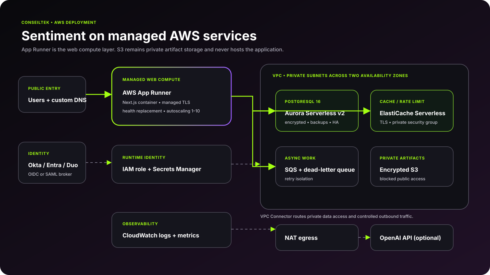
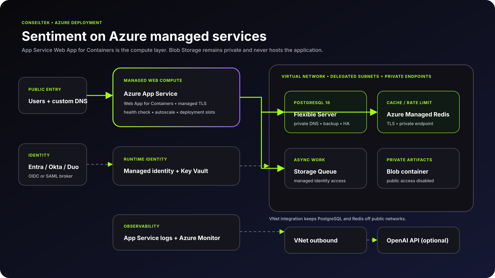

<div align="center">
  
  <h1>Sentiment</h1>
  <p><strong>Privacy-conscious engagement, performance, and action planning.</strong></p>
  <p>Enterprise SSO · feature-level RBAC · query-time anonymity · PostgreSQL · grounded AI · AWS and Azure IaC</p>
</div>

[](https://github.com/ConseilTek-Tektons/sentiment/actions/workflows/ci.yml)
[](https://github.com/ConseilTek-Tektons/sentiment/actions/workflows/codeql.yml)
[](LICENSE)

Sentiment is a deployable ConseilTek reference application for engagement surveys, performance cycles, goals, action plans, and people insights. It demonstrates a practical privacy boundary: directory identity and pseudonymous survey responses live in separate PostgreSQL schemas, while cohort anonymity is re-applied at query time.


## What is included

- Working Next.js 15 application with a polished, responsive people-analytics dashboard
- Engagement drivers, cohort insights, review-cycle progress, goals, and action-plan workflows
- Query-time anonymity enforcement with a minimum cohort of five—even after filters are applied
- Separated directory and response schemas; survey responses carry pseudonymous subject keys, not person foreign keys
- Feature-level RBAC for people operations, managers, employees, analysts, and viewers
- Generic OIDC for Okta and Microsoft Entra ID; SAML providers including Duo connect through Keycloak or another broker
- AI people-insights copilot with local grounded retrieval and optional OpenAI Responses API `file_search`
- PostgreSQL 16 migrations, Redis distributed limits, audit events, health checks, validation, and tests
- Complete local stack with PostgreSQL, Redis, and a preconfigured Keycloak realm
- Validated AWS App Runner/Aurora Serverless and Azure App Service/PostgreSQL Flexible Server infrastructure

## Run the complete local stack

```bash
cp .env.example .env
docker compose up --build
```

Open [http://localhost:3000](http://localhost:3000). Keycloak is at [http://localhost:8080](http://localhost:8080). See [Authentication](docs/AUTHENTICATION.md) for the imported realm and enterprise provider patterns. Demo personas let reviewers exercise different RBAC states; production disables them by default.

For manual development with Node.js 22+ and pnpm 11:

```bash
pnpm install
pnpm db:migrate
pnpm db:seed
pnpm dev
```

## Cloud deployment

Sentiment is a server-rendered application with authenticated APIs, protected analytics, SSO callbacks, database queries, and AI orchestration. Static website resources are therefore not an appropriate compute target.

| Cloud | Managed web compute | PostgreSQL | Cache | Deployment guide |
|---|---|---|---|---|
| AWS | AWS App Runner | Aurora PostgreSQL Serverless v2 | ElastiCache Serverless | [Terraform](infra/aws/README.md) |
| Azure | Azure App Service Web App for Containers | PostgreSQL Flexible Server | Azure Managed Redis | [Bicep](infra/azure/README.md) |

The managed runtime and data services reduce maintenance for operating systems, container replacement, TLS, autoscaling, database patching/backups, and cache operations. S3/Blob is private artifact storage only and is never the application host.





## Read the implementation guides

- [Architecture and privacy boundaries](docs/ARCHITECTURE.md)
- [Okta, Entra ID, Duo, OIDC, and SAML](docs/AUTHENTICATION.md)
- [RBAC policy](docs/RBAC.md)
- [AI and RAG](docs/AI.md)
- [Security](docs/SECURITY.md)
- [Operations](docs/OPERATIONS.md)

## Quality gates

```bash
pnpm check
terraform -chdir=infra/aws validate
bicep build infra/azure/main.bicep
docker build -t sentiment:local .
```

CI also compiles the container and both cloud definitions on every pull request.

## Repository map

```text
src/app/                 pages and authenticated API routes
src/components/          application shell, dashboard, AI, access UI
src/config/              product and RBAC policy configuration
src/lib/                 anonymity, authorization, DB, retrieval, limits
db/migrations/           directory, response, application, and audit schema
knowledge/               approved documents for optional RAG ingestion
deploy/keycloak/         local identity broker
infra/aws/               App Runner architecture in Terraform
infra/azure/             App Service architecture in Bicep
docs/architecture/       editable SVG architecture diagrams
```

## License

Apache 2.0. See [LICENSE](LICENSE). ConseilTek trademarks and supplied brand artwork remain the property of ConseilTek.
