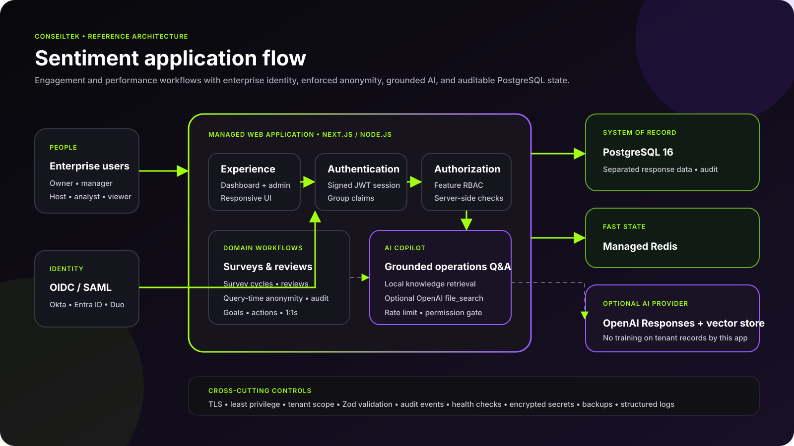

# Architecture and privacy boundaries

Sentiment is a modular monolith deployed as one standard container. The user interface, authenticated API, RBAC evaluator, privacy-safe query service, workflows, and AI orchestration share one release while retaining clear module boundaries. PostgreSQL is the durable system of record; Redis is used for distributed rate limiting.

## Request flow

1. AWS App Runner or Azure App Service terminates HTTPS and forwards to the Next.js container.
2. The enterprise OIDC provider authenticates the user. SAML can be brokered to OIDC through Keycloak.
3. Verified group claims map to an application role. Each protected server route independently enforces its permission.
4. Zod validates API input and the server derives organization scope from the signed session.
5. Cohort analytics call the `app.cohort_scores` function. Its `HAVING` clause applies the configured threshold, with an absolute minimum of five respondents, after the requested dimension is selected.
6. AI questions require `assistant.ask`, pass a Redis rate limit, and are grounded in approved people-operations knowledge or an optional vector store.

## Privacy boundary

| Schema | Contains | Must not contain |
|---|---|---|
| `directory` | people records, managers, department metadata | free-text survey answers |
| `responses` | cycles, questions, pseudonymous subject keys, answers | direct foreign keys to a person |
| `app` | privacy-safe functions, reviews, goals, action plans | endpoints that bypass anonymity checks |

Separating schemas is only one control. Production should use different database roles: a directory writer, a response writer, and an analytics role restricted to approved security-definer functions/views. Direct analyst access to raw response tables is not part of this reference flow.

## Why query-time anonymity matters

Masking a dashboard tile once is insufficient. Filters can shrink a safe cohort into an identifiable group. Sentiment therefore evaluates respondent count at the query that returns each result. The API receives either a released score or a masked record with no average.

## Deployment position

Sentiment requires server execution and is never deployed as a static web app. App Runner and App Service Web App for Containers reduce routine host/orchestrator maintenance while the managed PostgreSQL services handle backup and engine operations.
